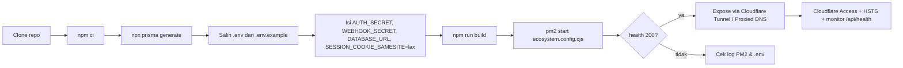

# AfterSales Pro — Gambaran Arsitektur & Deploy

Dokumen ini merangkum bentuk aplikasi AfterSales Pro beserta alur deploy-nya,
agar mudah dipahami sebelum dipasang di server produksi.

---

## 1. Gambaran umum

AfterSales Pro adalah aplikasi **Next.js (App Router)** dengan output
**standalone**, berjalan di atas **Node.js**, database **SQLite** (Prisma),
dilindungi **JWT cookie**, dan dirancang untuk diakses lewat **Cloudflare**
(Tunnel atau Proxied DNS).

```
┌──────────────────────────────────────────────────────────────────────┐
│                         PENGGUNA / PERANGKAT                         │
│   Browser (web)  ·  Aplikasi mobile (scan QR)  ·  Telegram Bot       │
└──────────────┬───────────────────────────┬────────────────────────────┘
               │ HTTPS                     │ webhook / polling
               ▼                           ▼
┌──────────────────────────────────────────────────────────────────────┐
│                    CLOUDFLARE (edge)                                 │
│   SSL/TLS · WAF · Rate limit · IP asli (CF-Connecting-IP)            │
│   Access (Zero Trust) untuk rute sensitif — kecualikan webhook       │
└──────────────┬───────────────────────────────────────────────────────┘
               │ HTTP/HTTPS (hanya IP Cloudflare)
               ▼
┌──────────────────────────────────────────────────────────────────────┐
│                    SERVER ORIGIN (VPS / on-prem)                     │
│                                                                      │
│   ┌────────────────────────────────────────────────────────────┐     │
│   │  PM2: aspro-prod                                           │     │
│   │   node .next/standalone/server.js  (Next.js, port 3000)     │     │
│   │   • App Router (UI + API routes)                           │     │
│   │   • Middleware: sesi JWT + CSRF (Origin/Referer)           │     │
│   │   • /api/health (publik) untuk uptime monitor              │     │
│   └──────────────┬─────────────────────────────────────────────┘     │
│                  │ Prisma Client                                      │
│                  ▼                                                    │
│   ┌────────────────────────────────────────────────────────────┐     │
│   │  SQLite: db/custom.db                                      │     │
│   │   • master sparepart, unit, tiket service, klaim, dll.     │     │
│   │   • backup rutin → db/backups/ & db/snapshots/             │     │
│   └────────────────────────────────────────────────────────────┘     │
│                                                                      │
│   ┌────────────────────────────────────────────────────────────┐     │
│   │  PM2: aspro-tg-poll (opsional)                             │     │
│   │   mini-services/tg-polling.mjs — bridge Telegram inbound   │     │
│   │   (long polling; dipakai bila tidak ada URL publik)         │     │
│   └────────────────────────────────────────────────────────────┘     │
└──────────────────────────────────────────────────────────────────────┘
```

---

## 2. Komponen aplikasi

| Komponen | Teknologi | Peran |
|---|---|---|
| Frontend + API | Next.js 16 (App Router), React 19, Tailwind | UI web + endpoint REST di `/api/*` |
| Runtime server | Node.js (standalone build) | `node .next/standalone/server.js` |
| Database | SQLite + Prisma 6 | Data tunggal, path absolut di `DATABASE_URL` |
| Proses manager | PM2 (`ecosystem.config.cjs`) | `aspro-prod` + `aspro-tg-poll`, autorestart |
| Reverse proxy/TLS | Cloudflare (Tunnel / Proxied DNS) atau Caddy | HTTPS, WAF, IP asli |
| Desktop (opsional) | Electron (`electron/`) | App desktop lokal |
| Telegram | `mini-services/tg-polling.mjs` | Inbound bot bridge |
| QR/Barcode | `src/lib/kode-unit.ts` | Stiker unit 4 identifikasi |

---

## 3. Alur deploy (ringkas)



Perintah inti:

```bash
npm ci
npx prisma generate
npm run build          # output standalone -> .next/standalone
pm2 start ecosystem.config.cjs
pm2 save
```

Verifikasi:

```bash
curl -s http://localhost:3000/api/health   # harus 200
pm2 status
```

---

## 4. File & data yang harus di-backup

| Path | Isi | Wajib backup? |
|---|---|---|
| `db/custom.db` | Database utama | ✅ (harian) |
| `db/backups/` | Backup otomatis sebelum build | ✅ |
| `db/snapshots/` | Snapshot git data | ✅ |
| `upload/`, `download/` | File unggahan & hasil ekspor | ✅ |
| `.env` | Secret & konfigurasi | ✅ (aman, jangan commit) |
| `.next/standalone/` | Hasil build | ❌ (bisa dibangun ulang) |

> **Catatan:** build otomatis mem-backup DB (`scripts/backup-db.mjs`) sebelum
> build; build dibatalkan bila backup gagal (set `BACKUP_SKIP=1` untuk paksa).

---

## 5. Batasan penting

- **SQLite = satu instance.** Jangan jalankan beberapa replika terhadap
  `db/custom.db` yang sama. Ketersediaan dijaga dengan autorestart PM2/systemd
  + backup rutin.
- **Origin tidak boleh diakses langsung** (pakai Tunnel atau firewall IP
  Cloudflare) agar header IP asli (`CF-Connecting-IP`) tidak bisa dipalsukan.
- **Operasi berat** (backup ke Google Sheets, impor massal, restore DB, PDF)
  bisa melewati timeout ~100s Cloudflare — jalankan di luar jam sibuk.
- **Webhook** (`/api/wa/webhook`, `/api/telegram/webhook`) wajib
  `WEBHOOK_SECRET`; kecualikan dari Cloudflare Access.

---

## 6. Environment produksi (ringkas)

| Variabel | Wajib | Keterangan |
|---|---|---|
| `DATABASE_URL` | ✅ | Path absolut, mis. `file:/opt/aftersales-pro/db/custom.db` |
| `AUTH_SECRET` | ✅ | Secret acak panjang; server **menolak boot** bila kosong |
| `WEBHOOK_SECRET` | ⭐ | Pengaman webhook publik |
| `SESSION_COOKIE_SAMESITE` | ⭐ | `lax` untuk akses top-level (lebih aman/CSRF) |
| `PORT` / `HOSTNAME` | – | Default 3000 / 0.0.0.0 |

Generate secret:

```bash
node -e "console.log(require('crypto').randomBytes(32).toString('hex'))"
```

---

## 7. Checklist produksi

- [ ] `AUTH_SECRET` acak panjang terisi
- [ ] `WEBHOOK_SECRET` terisi
- [ ] `SESSION_COOKIE_SAMESITE=lax`
- [ ] `DATABASE_URL` path absolut & folder `db/` ter-backup rutin
- [ ] Origin tidak dapat diakses langsung (Tunnel / firewall IP Cloudflare)
- [ ] Cloudflare SSL = **Full (Strict)**, HSTS aktif
- [ ] Cloudflare Access untuk rute sensitif; kecualikan path webhook
- [ ] `/api/health` dipasang di uptime monitor
- [ ] PM2 autorestart aktif (`pm2 save` + startup hook)

---

## 8. Referensi

- Panduan detail Cloudflare: `README-DEPLOY-CLOUDFLARE.md`
- Panduan desktop (Electron): `README-DESKTOP.md`
- Ecosystem PM2: `ecosystem.config.cjs`
- Konfigurasi build: `next.config.ts`
- Contoh env: `.env.example`
- Skema database: `prisma/schema.prisma`
