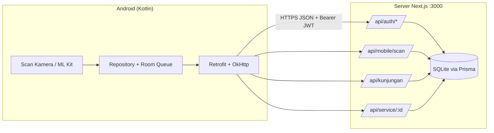
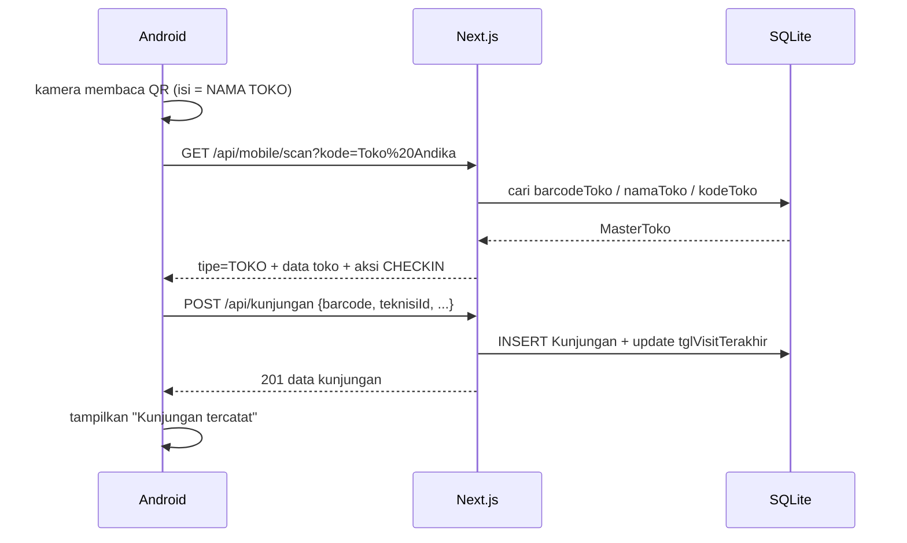
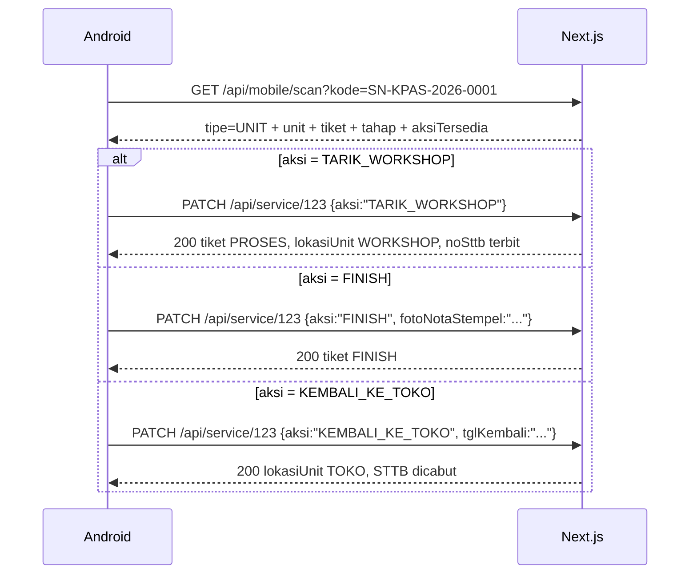
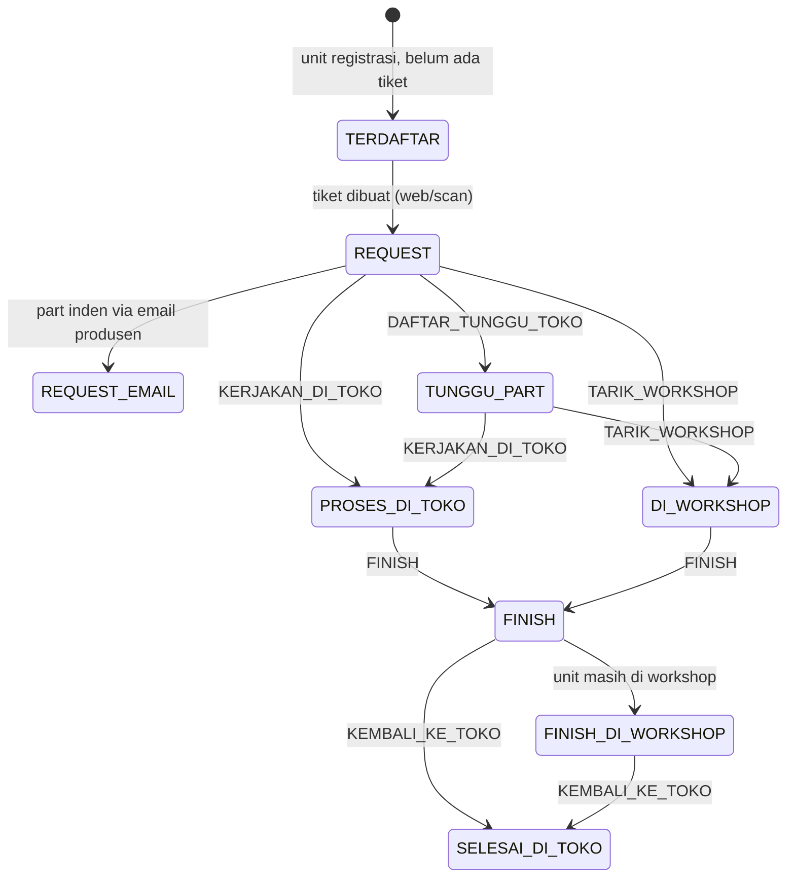
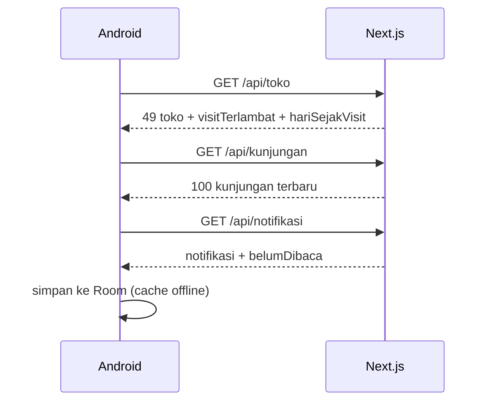

# Skema Komunikasi Mobile (Kotlin) ⇄ Web After-Sales

Dokumen ini adalah kontrak komunikasi antara **aplikasi Android (Kotlin)** dan
**backend web (Next.js + Prisma)** untuk dua alur utama:

1. **Scan QR toko** → otomatis mencatat kunjungan (tersambung ke Field Ops).
2. **Scan QR produk/unit** → membaca tahap terakhir lalu memindahkan unit ke
   tahap berikutnya (kerjakan di toko, bawa ke workshop, finish, kirim balik ke toko).

Semua data tetap satu sumber: tabel yang sama dengan web (`MasterToko`,
`Kunjungan`, `UnitAsset`, `ServiceRequest`). Tidak ada database terpisah di HP.

---

## 1. Arsitektur



| Lingkungan | Base URL | Catatan |
|---|---|---|
| Emulator Android | `http://10.0.2.2:3000` | `10.0.2.2` = localhost komputer host |
| HP fisik di LAN | `http://<IP-LAN-PC>:3000` | butuh `usesCleartextTraffic` saat uji |
| Produksi | `https://<domain-anda>` | wajib HTTPS |

> Untuk uji LAN, tambahkan `network_security_config.xml` yang mengizinkan
> cleartext hanya untuk IP lokal — jangan aktifkan cleartext global di produksi.

---

## 2. Autentikasi

### 2.1 Login

`POST /api/auth/login`

```json
{ "email": "dazz", "password": "••••••" }
```

`email` boleh **email atau username**. Respons sukses (`200`):

```json
{
  "ok": true,
  "token": "eyJhbGciOiJIUzI1NiIs...",
  "user": { "id": 26, "nama": "Admin Workshop", "email": "...", "username": "dazz", "role": "ADMIN_WORKSHOP" }
}
```

- Token = JWT HS256, berlaku **7 hari** (`sub`, `nama`, `email`, `username`, `role`).
- Server juga mengirim cookie `aspro_session`, tetapi **mobile cukup memakai Bearer**.
- Simpan token di `EncryptedSharedPreferences`, bukan `SharedPreferences` biasa.

### 2.2 Memakai token

Semua endpoint tulis & endpoint mobile wajib mengirim:

```
Authorization: Bearer <token>
Content-Type: application/json
Accept: application/json
```

### 2.3 Sesi berakhir

| Kondisi | Respons | Tindakan mobile |
|---|---|---|
| Token tidak ada / kedaluwarsa | `401 { "error": "Tidak terautentikasi. Silakan login." }` | Hapus token → tampilkan layar login |
| Akun dinonaktifkan | `401 { "error": "Sesi berakhir atau akun nonaktif..." }` | Logout paksa |
| Role tidak berwenang | `403 { "error": "Akses ditolak: ..." }` | Sembunyikan aksi, jangan retry |

Tidak ada refresh token. Saat `401`, login ulang (token baru otomatis berlaku).

### 2.4 Role

`ADMIN_WORKSHOP`, `MANAGER`, `TEKNISI`, `PRODUSEN`.

- Scan kunjungan & ubah tahap tiket: **semua user aktif** (termasuk `TEKNISI`).
- Master data, hapus unit, koreksi part, klaim: `ADMIN_WORKSHOP`/`MANAGER`.
- Mobile sebaiknya menyembunyikan menu master untuk role `TEKNISI`.

### 2.5 Tidak ada "API secret" — yang dipakai adalah token login

Aplikasi mobile **tidak** memakai API key statis. Satu-satunya kredensial adalah
JWT dari `POST /api/auth/login` (masa berlaku 7 hari). `AUTH_SECRET` di `.env`
hanya kunci penanda tangan JWT di server dan **tidak boleh** ditanam di APK.

Akun untuk mobile dibuat dari web: **Pengguna → Tambah**. Password default
`aftersales123` (minimal 6 karakter) — minta user menggantinya. Role `TEKNISI`
sudah cukup untuk scan kunjungan dan memindahkan tahap tiket.

Untuk uji cepat di PC (tanpa membuka aplikasi):

```bash
node scripts/mobile-token.mjs dazz RAHASIA
node scripts/mobile-token.mjs dazz RAHASIA 2603128725B
```

Script mencetak token, masa berlaku, base URL per skenario (USB/emulator/Wi-Fi),
dan opsional langsung menguji satu kode lewat `/api/mobile/scan`.
Agar password tidak tersimpan di riwayat shell:

```powershell
$env:MOBILE_EMAIL="dazz"; $env:MOBILE_PASS="RAHASIA"; node scripts/mobile-token.mjs
```

---

## 3. Konvensi umum

- Body & respons: **JSON UTF-8**. Tanggal: **ISO-8601** (`2026-11-02T08:15:00.000Z`).
- Angka ID: integer. Semua nominal rupiah: number (bukan string).
- Sukses: `200` (GET/PATCH) atau `201` (POST create).
- Error selalu berbentuk `{ "error": "pesan siap tampil" }`.
- `409` = **aturan alur bisnis** (bukan bug): tampilkan pesan server apa adanya,
  jangan retry otomatis.
- `404` = kode tidak dikenal / data hilang.
- `429` = throttle login (10 gagal / 5 menit / IP).
- Timeout yang disarankan: connect 10 s, read 20 s (upload foto 60 s).

### Peta endpoint yang dipakai mobile

| Kebutuhan | Method & path | Auth |
|---|---|---|
| Login | `POST /api/auth/login` | publik |
| Profil sesi | `GET /api/auth/me` | publik (cookie/Bearer) |
| **Scan apa pun (toko/unit/tiket)** | `GET /api/mobile/scan?kode=...` | Bearer |
| Pratinjau toko (tanpa mencatat) | `GET /api/kunjungan/lookup?barcode=...` | Bearer |
| Catat kunjungan | `POST /api/kunjungan` | Bearer |
| Riwayat kunjungan | `GET /api/kunjungan` | Bearer |
| Daftar toko + status visit | `GET /api/toko` | Bearer |
| Daftar unit + tiket ringkas | `GET /api/unit` | Bearer |
| Daftar tiket lengkap | `GET /api/service` | Bearer |
| Detail tiket | `GET /api/service/{id}` | Bearer |
| **Ubah tahap tiket** | `PATCH /api/service/{id}` | Bearer |
| Notifikasi in-app | `GET /api/notifikasi` | Bearer |

> Hampir semua `/api/*` dilindungi lapisan proxy: tanpa `Authorization: Bearer`
> (atau cookie sesi) server membalas `401 {"error":"Tidak terautentikasi. Silakan login."}`.
> Request dengan Bearer otomatis lolos proteksi CSRF, jadi mobile tidak perlu
> mengirim `Origin`/`Referer`.

---

## 4. Alur 1 — Scan QR toko → catat kunjungan

### 4.1 Urutan



### 4.2 Respons scan toko

```json
{
  "ok": true,
  "tipe": "TOKO",
  "kode": "Toko Andika",
  "toko": {
    "id": 32, "kodeToko": "TOK-032", "namaToko": "Toko Andika",
    "alamat": "Jl. ...", "kontak": "08...",
    "latitude": -4.54, "longitude": 120.31,
    "frekuensiVisit": 14, "tglVisitTerakhir": "2026-10-20T03:00:00.000Z",
    "barcodeToko": "Toko Andika", "aktif": true, "modeSiklus": "REGULER"
  },
  "jumlahUnit": 12,
  "totalKunjungan": 8,
  "hariSejakVisit": 13,
  "visitTerlambat": false,
  "kunjunganTerakhir": { "waktu": "...", "teknisi": "Andi", "metode": "SCAN_BARCODE" },
  "aksiTersedia": [
    { "aksi": "CHECKIN", "label": "Catat Kunjungan", "endpoint": "POST /api/kunjungan" }
  ]
}
```

Kode yang diterima: **nama toko** (QR baru), `BC-TOK-032` (stiker lama),
`TOK-032`, dan nama toko dengan huruf besar/kecil berbeda.

### 4.3 Catat kunjungan

`POST /api/kunjungan`

```json
{
  "barcode": "Toko Andika",
  "teknisiId": 5,
  "metodeCheckin": "SCAN_BARCODE",
  "tglKunjungan": "2026-11-02T08:15:00.000Z",
  "catatanStokRusak": "2 unit display berderit",
  "fotoOnsite": "data:image/jpeg;base64,..."
}
```

- `barcode` **atau** `tokoId` (wajib salah satu).
- `teknisiId` wajib (id user teknisi yang login; ambil dari `user.id` saat login).
- `tglKunjungan` opsional (backdate maksimal besok).
- `fotoOnsite` opsional (data URI/base64 — kompres ≤ 1 MB).

Respons `201`: objek `Kunjungan` + `toko` + `teknisi`.
Server otomatis memperbarui `tglVisitTerakhir` toko sehingga status Field Ops
(ON TRACK / TERLAMBAT) langsung berubah di web.

### 4.4 Anti dobel check-in (penting untuk offline)

Server **tidak** menolak check-in ganda. Aturan di mobile:

1. Tombol check-in hanya aktif sekali per hasil scan (single-flight).
2. Sebelum kirim, cek `GET /api/kunjungan` (100 terbaru): bila ada entri dengan
   `barcodeTerscan` sama, `teknisiId` sama, dan `tglKunjungan` dalam ±10 menit →
   anggap sudah tercatat.
3. Bila POST timeout (bukan 4xx), **jangan langsung retry**; lakukan langkah 2.
   Bila tidak ketemu, baru kirim ulang dengan `clientRequestId` yang sama di queue lokal.

---

## 5. Alur 2 — Scan QR produk → pindah tahap

### 5.1 Kode pada stiker unit

QR unit berisi **4 identifikasi** dalam satu baris (pemisah `|`):

```
SN:<nomor seri>|MOD:<model>|TOK:<toko/customer>|NAMA:<nama produk>
```

Contoh nyata:

```
SN:2603128725B|MOD:RI-712GA(B)|TOK:Toko Semeru Ahmad Yani|NAMA:Kulkas 2 Pintu
```

Aturan penting:

- **Tag ID = nilai `SN:`** (nomor seri), **bukan** seluruh teks QR. Aplikasi
  mobile harus mengambil bagian setelah `SN:`.
- `SN:` selalu di depan → aplikasi/pembaca lama yang hanya mencari `SN:` tetap jalan.
- QR lama yang **hanya berisi nomor seri** dan format lama
  `SN:xxx|MOD:yyy|TOK:zzz` tetap dikenali (tanpa `NAMA:`).
- Nomor tiket (`SVC-2611-0001`) juga bisa discan.
- Nilai dibatasi panjangnya (SN 32, model 24, nama 36, toko 30 karakter) agar QR
  tetap renggang dan mudah dipindai saat dicetak mini 28 mm. Data **lengkap**
  tetap dikirim server di `identifikasi`.

### 5.2 Identifikasi produk (4 komponen)

Stiker unit memuat **4 identifikasi utama**:

| Komponen | Sumber | Keterangan |
|---|---|---|
| Nama produk | `unit.nama` (fallback `modelUnit`) | nama panggilan unit — `NAMA:` |
| Model | `unit.modelUnit` | tipe/model unit — `MOD:` |
| Nomor seri | `unit.serialNumber` | **Tag ID** & kunci unik — `SN:` |
| Toko | `unit.toko.namaToko` (fallback `customer.nama`) | **otomatis** dari data unit / scan toko pertama — `TOK:` |

`waktuScan` **tidak dicetak** di stiker (tidak mungkin diketahui sebelum discan).
Waktu scan dihasilkan saat pemindaian: server mengembalikannya di
`identifikasi.waktuScan`, dan aplikasi mobile boleh memakai waktu lokal perangkat.

Aplikasi mobile boleh memakai isi QR langsung (tanpa jaringan), lalu
menyegarkan dengan `GET /api/mobile/scan` saat online. Server selalu memakai
**database** sebagai sumber `identifikasi`, sehingga koreksi data di web ikut
terbaca walau stiker lama sudah terlanjur dicetak.

Stiker bisa dicetak dalam 3 ukuran (dropdown **Kertas**):

| Pilihan | Lebar stiker | Pemakaian |
|---|---|---|
| A4 | 44 mm | printer biasa |
| Label Thermal 58 mm | 36 mm | printer label portable |
| **Mini 28 mm** | 28 mm | label kecil / hemat tempat |

### 5.3 Urutan



### 5.4 Respons scan unit

```json
{
  "ok": true,
  "tipe": "UNIT",
  "kode": "SN-KPAS-2026-0001",
  "unit": {
    "id": 91, "serialNumber": "SN-KPAS-2026-0001", "modelUnit": "Kipas Angin",
    "merk": "Miyako", "nama": "Kipas Ruang Tamu", "statusGaransi": "GARANSI",
    "kerusakanAwal": "Tidak mau berputar",
    "toko": { "id": 32, "kodeToko": "TOK-032", "namaToko": "Toko Andika" },
    "customer": null
  },
  "identifikasi": {
    "namaProduk": "Kipas Ruang Tamu",
    "model": "Kipas Angin",
    "nomorSeri": "SN-KPAS-2026-0001",
    "namaToko": "Toko Andika",
    "waktuScan": "2026-11-02T08:15:00.000Z"
  },
  "tiket": {
    "id": 123, "noTiket": "SVC-2611-0001", "status": "PROSES",
    "penanganan": "TARIK_WORKSHOP", "lokasiUnit": "WORKSHOP",
    "noSttb": "STTB-2611-0001", "tglFinish": null, "tglKembaliKeToko": null,
    "parts": [
      { "id": 1, "kodePart": "KP-001", "namaPart": "Kapasitor", "qty": 1,
        "statusPart": "READY", "statusKonfirmasi": "READY" }
    ]
  },
  "tahap": "DI_WORKSHOP",
  "tahapLabel": "Unit di workshop",
  "aksiTersedia": [
    { "aksi": "FINISH", "label": "Selesaikan (Finish)", "endpoint": "PATCH /api/service/123" },
    { "aksi": "KEMBALI_KE_TOKO", "label": "Kirim Balik ke Toko", "endpoint": "PATCH /api/service/123" }
  ]
}
```

Bila nomor seri dipakai beberapa unit:

```json
{ "ok": true, "tipe": "UNIT_GANDA", "pesan": "2 unit memakai nomor seri yang sama — pilih salah satu", "kandidat": [ ... ] }
```

Bila tidak dikenal: `404 { "ok": false, "tipe": "TIDAK_DIKENAL", "error": "..." }`.

### 5.5 State machine tahap



### 5.6 Tabel aksi `PATCH /api/service/{id}`

Body selalu `{ "aksi": "<NAMA>", "aktor": "mobile:<nama teknisi>", ...field }`.
`aktor` opsional tetapi **sangat disarankan** agar Audit Log jelas.

| Aksi | Dari status | Efek | Field tambahan | Error khas |
|---|---|---|---|---|
| `DAFTAR_TUNGGU_TOKO` | `REQUEST` | `penanganan=TUNGGU_PART_TOKO`, unit tetap di toko | – | `409` bukan REQUEST |
| `KERJAKAN_DI_TOKO` | `REQUEST` / `PROSES`+`BELUM` | `PROSES`, `DI_TOKO`, `lokasi=TOKO`, STTB terbit | – | `409` ada part belum READY |
| `TARIK_WORKSHOP` | `REQUEST` / `PROSES`+`BELUM` | `PROSES`, `TARIK_WORKSHOP`, `lokasi=WORKSHOP`, STTB terbit | – | `409` ada part belum READY |
| `FINISH` | `PROSES` **dan semua part READY** | `status=FINISH`, `tglFinish` | `tglFinish?`, `fotoNotaStempel?`, `tandaTanganDigital?` | `409` bukan PROSES; `409` masih ada part belum datang; `400` tanggal tidak valid |
| `KEMBALI_KE_TOKO` | `PROSES` / `FINISH` | `lokasi=TOKO`, `sttbDicabut=true`, `tglKembaliKeToko` | `tglKembali?` | `409` sudah pernah; `400` tanggal di masa depan |
| `MULAI_PROSES` | `REQUEST` | `PROSES` + STTB (langsung tarik workshop) | – | `409` belum ada part READY |
| `KIRIM_PART_RUSAK` | `PROSES` | catat `noSuratJalan` | `noSuratJalan` (wajib) | `400` kosong |

Contoh FINISH:

```http
PATCH /api/service/123
Authorization: Bearer <token>
Content-Type: application/json

{
  "aksi": "FINISH",
  "aktor": "mobile:Budi",
  "tglFinish": "2026-11-02T09:30:00.000Z",
  "fotoNotaStempel": "data:image/jpeg;base64,..."
}
```

Respons: objek `ServiceRequest` terbaru (termasuk `status`, `lokasiUnit`,
`penanganan`, `noSttb`, `tglFinish`, `tglKembaliKeToko`).

> **Penting:** `FINISH` tidak otomatis berarti unit sudah di toko. Setelah
> `FINISH`, panggil `KEMBALI_KE_TOKO` saat unit benar-benar sampai toko.
> Jika unit dikerjakan di toko (`KERJAKAN_DI_TOKO`), `KEMBALI_KE_TOKO` tetap
> boleh dipakai untuk mencatat unit selesai/serah terima.

> **Part bergelombang (satu unit, satu tiket):** satu unit bisa rusak di
> beberapa bagian (top plate, side, rear, …). Setelah part gelombang pertama
> datang, temuan baru **tidak** memerlukan tiket baru — panggil `TAMBAH_PART`
> di tiket yang sama (stok kurang otomatis menjadi `ORDER_PRODUSEN`).
> Selama masih ada baris part `qty > 0` dengan `statusPart != "READY"`:
> - `FINISH` **tidak ditawarkan** di `aksiTersedia`, dan bila tetap dipanggil
>   server menjawab `409` dengan daftar part yang ditunggu;
> - `KEMBALI_KE_TOKO` tetap boleh (unit bisa sudah berada di toko);
> - setelah semua part `READY` dan dipasang, `FINISH` muncul kembali.
>
> Bila tiket sudah terlanjur `FINISH`, gunakan `BUKA_ULANG_PROSES`
> (Admin Workshop/Manager + `koreksiSelesai: true`) — bukan membuat tiket baru.
> SOP lengkap: `docs/alur-part-bergelombang.md`.

### 5.7 Aturan tanggal (ditegakkan server)

- `tglFinish` tidak boleh di masa depan dan tidak boleh lebih awal dari
  `tglPartDatang`, part terpasang, atau `tglKembaliKeToko` (minimal sama hari).
- `tglKembali` tidak boleh di masa depan / sebelum tiket dibuat / sebelum `tglFinish`.
- Format salah → `400` dengan pesan yang bisa langsung ditampilkan.

Mobile sebaiknya mengirim waktu **lokal perangkat dalam ISO-8601 dengan zona**
(`2026-11-02T09:30:00+08:00`) atau UTC (`...Z`). Jangan mengirim tanggal tanpa jam.

---

## 6. Sinkronisasi Field Ops

Saat aplikasi dibuka / tarik-to-refresh:



- `GET /api/toko` → array `MasterToko` + `jumlahUnit`, `visitTerlambat`, `hariSejakVisit`.
- `GET /api/kunjungan` → 100 kunjungan terbaru (desc), sudah termasuk `toko` & `teknisi`.
- `GET /api/notifikasi` → `{ items, belumDibaca, total }` (maks 50).
- `GET /api/unit` → semua unit + `barcodeData` (`SN:...|MOD:...|TOK:...`) + tiket ringkas.

Urutan prioritas offline: toko → unit → tiket → kunjungan.

---

## 7. Strategi offline & retry

1. **Room DB** menyimpan antrean aksi: `{ id, tipe, endpoint, body, status, percobaan, createdAt }`.
2. Aksi tulis (`POST /api/kunjungan`, `PATCH /api/service`) masuk antrean dulu,
   UI optimistis, lalu worker mengirim saat online.
3. **Jangan retry** untuk `400`, `401`, `403`, `404`, `409` — tandai `GAGAL_PERMANEN`
   dan tampilkan alasan.
4. Retry hanya untuk `5xx`, timeout, dan error jaringan: backoff eksponensial
   `1 s → 2 s → 4 s → 8 s → 30 s` (maks 5 percobaan).
5. Aksi tahap bersifat **idempoten secara alur**: mengulang `FINISH`/`KEMBALI_KE_TOKO`
   yang sudah sukses akan dijawab `409` — perlakukan `409` pada replay sebagai
   "sudah tercatat", lalu sinkronkan ulang state.
6. Foto disimpan sebagai file di storage internal + URI di antrean; unggah
   base64 hanya saat mengirim.

---

## 8. Keamanan

- Token JWT disimpan di `EncryptedSharedPreferences`; jangan pernah di log.
- Wajib HTTPS di produksi. Untuk uji LAN, whitelist IP di `network_security_config`.
- Jangan menaruh `AUTH_SECRET`, password DB, atau token gateway di APK.
- Sembunyikan aksi berdasarkan role; server tetap menolak (`403`) bila dipaksa.
- Validasi hasil scan: batasi panjang kode (mis. ≤ 120 karakter), tolak karakter kontrol.
- Logout: hapus token + bersihkan cache Room yang berisi data pelanggan.

---

## 9. Contoh implementasi Kotlin (Retrofit + OkHttp)

```kotlin
// build.gradle.kts
// implementation("com.squareup.retrofit2:retrofit:2.11.0")
// implementation("com.squareup.retrofit2:converter-moshi:2.11.0")
// implementation("com.squareup.okhttp3:logging-interceptor:4.12.0")

data class LoginRequest(val email: String, val password: String)
data class LoginResponse(val ok: Boolean, val token: String, val user: UserDto)
data class UserDto(val id: Int, val nama: String, val email: String, val role: String)

data class ScanResponse(
    val ok: Boolean,
    val tipe: String,              // TOKO | UNIT | UNIT_GANDA | TIKET | TIDAK_DIKENAL
    val kode: String,
    val toko: TokoDto? = null,
    val unit: UnitDto? = null,
    val identifikasi: IdentifikasiDto? = null,
    val tiket: TiketDto? = null,
    val tahap: String? = null,
    val tahapLabel: String? = null,
    val aksiTersedia: List<AksiDto> = emptyList(),
    val kandidat: List<UnitDto> = emptyList(),
    val error: String? = null,
)

data class IdentifikasiDto(
    val tagId: String,             // = nomorSeri (Tag ID pada layar scan)
    val namaProduk: String,
    val model: String,
    val nomorSeri: String,
    val namaToko: String?,
    val waktuScan: String,         // ISO-8601 dari server
)

/**
 * Urai isi QR stiker unit:
 *   SN:<nomor seri>|MOD:<model>|TOK:<toko>|NAMA:<nama produk>
 * Stiker lama hanya berisi nomor seri → tetap terbaca (SN = seluruh teks).
 */
object KodeUnit {
    data class Identitas(
        val tagId: String,
        val model: String,
        val toko: String,
        val namaProduk: String,
    )

    fun urai(kode: String): Identitas? {
        val teks = kode.trim()
        if (teks.isEmpty()) return null
        val peta = teks.split('|')
            .mapNotNull { bagian ->
                val i = bagian.indexOf(':')
                if (i <= 0) null
                else bagian.substring(0, i).trim().uppercase() to bagian.substring(i + 1).trim()
            }
            .toMap()
        val sn = peta["SN"] ?: teks   // stiker lama: seluruh isi QR = nomor seri
        return Identitas(
            tagId = sn,
            model = peta["MOD"].orEmpty(),
            toko = peta["TOK"].orEmpty(),
            namaProduk = peta["NAMA"].orEmpty(),
        )
    }
}

data class AksiDto(val aksi: String, val label: String, val endpoint: String? = null)

data class CheckinRequest(
    val barcode: String,
    val teknisiId: Int,
    val metodeCheckin: String = "SCAN_BARCODE",
    val tglKunjungan: String? = null,
    val catatanStokRusak: String? = null,
    val fotoOnsite: String? = null,
)

data class AksiTiketRequest(
    val aksi: String,
    val aktor: String? = null,
    val tglFinish: String? = null,
    val tglKembali: String? = null,
    val fotoNotaStempel: String? = null,
)

interface AsproApi {
    @POST("api/auth/login")
    suspend fun login(@Body body: LoginRequest): LoginResponse

    @GET("api/mobile/scan")
    suspend fun scan(@Query("kode") kode: String): ScanResponse

    @POST("api/kunjungan")
    suspend fun checkin(@Body body: CheckinRequest): Response<Unit>

    @PATCH("api/service/{id}")
    suspend fun aksiTiket(@Path("id") id: Int, @Body body: AksiTiketRequest): Response<Unit>
}

class AuthInterceptor(private val tokenProvider: () -> String?) : Interceptor {
    override fun intercept(chain: Interceptor.Chain): okhttp3.Response {
        val token = tokenProvider()
        val req = chain.request().newBuilder().apply {
            if (!token.isNullOrBlank()) header("Authorization", "Bearer $token")
            header("Accept", "application/json")
        }.build()
        return chain.proceed(req)
    }
}
```

Contoh pemakaian:

```kotlin
val kodeDariKamera = "SN:2603128725B|MOD:RI-712GA(B)|TOK:Toko Semeru|NAMA:Kulkas 2 Pintu"

// 1) Tampilkan 4 identifikasi langsung dari QR (tanpa jaringan, tanpa menebak)
val stiker = KodeUnit.urai(kodeDariKamera)
// stiker.tagId      = "2603128725B"  ← Tag ID
// stiker.namaProduk = "Kulkas 2 Pintu"
// stiker.model      = "RI-712GA(B)"
// stiker.toko       = "Toko Semeru"

// 2) Segarkan dari server (data database + tahap + aksi)
val hasil = api.scan(kodeDariKamera)

when (hasil.tipe) {
    "TOKO" -> {
        api.checkin(
            CheckinRequest(
                barcode = hasil.kode,
                teknisiId = sesi.user.id,
                catatanStokRusak = catatan.ifBlank { null },
            )
        )
        // tampilkan nama toko + alamat + koordinat
    }
    "UNIT", "TIKET" -> {
        val info = hasil.identifikasi            // sumber: database
        val tiket = hasil.tiket ?: return
        val aksi = pilihAksi(hasil.aksiTersedia) // mis. TARIK_WORKSHOP
        api.aksiTiket(tiket.id, AksiTiketRequest(aksi = aksi.aksi, aktor = "mobile:${sesi.user.nama}"))
    }
    else -> tampilkanError(hasil.error ?: "Kode tidak dikenali")
}
```

> `PATCH` di Retrofit butuh `@PATCH` dari Retrofit 2.6+ (sudah tersedia di 2.11).

---

## 10. Uji cepat dengan curl

```bash
# 1) login
curl -s -X POST http://localhost:3000/api/auth/login \
  -H "Content-Type: application/json" \
  -d '{"email":"dazz","password":"RAHASIA"}'

# 2) scan toko (ganti TOKEN)
curl -s "http://localhost:3000/api/mobile/scan?kode=Toko%20Andika" \
  -H "Authorization: Bearer TOKEN"

# 3) scan unit — isi QR stiker (URL-encode karakter | dan spasi)
curl -s "http://localhost:3000/api/mobile/scan?kode=SN%3A2603128725B%7CMOD%3ARI-712GA(B)%7CTOK%3AToko%20Semeru%7CNAMA%3AKulkas%202%20Pintu" \
  -H "Authorization: Bearer TOKEN"

# 3b) stiker lama / nomor seri saja — tetap didukung
curl -s "http://localhost:3000/api/mobile/scan?kode=2603128725B" \
  -H "Authorization: Bearer TOKEN"

# 4) check-in
curl -s -X POST http://localhost:3000/api/kunjungan \
  -H "Authorization: Bearer TOKEN" -H "Content-Type: application/json" \
  -d '{"barcode":"Toko Andika","teknisiId":5,"metodeCheckin":"SCAN_BARCODE"}'

# 5) tarik ke workshop
curl -s -X PATCH http://localhost:3000/api/service/123 \
  -H "Authorization: Bearer TOKEN" -H "Content-Type: application/json" \
  -d '{"aksi":"TARIK_WORKSHOP","aktor":"mobile:Budi"}'
```

---

## 11. Ringkasan keputusan desain

| Keputusan | Alasan |
|---|---|
| Satu endpoint scan (`/api/mobile/scan`) | HP tidak perlu tahu apakah kode itu toko, unit, atau tiket |
| Penulisan memakai endpoint web yang ada | Satu sumber aturan bisnis, tidak ada logika ganda |
| `aksiTersedia` dikirim server | Tombol di HP selalu sesuai state & guard server |
| `409` = aturan bisnis | Mobile tidak retry, cukup tampilkan pesan |
| QR toko berisi nama toko | Hasil scan langsung terbaca manusia; kode lama tetap didukung |
| QR unit berisi 4 identifikasi (`SN:\|MOD:\|TOK:\|NAMA:`) | HP bisa menampilkan nama/model/toko tanpa jaringan; `SN:` = Tag ID dan tetap kompatibel dengan stiker lama |

---

## 12. Uji di HP lewat USB (adb reverse)

HP yang dihubungkan USB **bisa** dipakai menguji aplikasi terhadap server PC —
tidak perlu Wi-Fi sama sekali.

### 12.1 Prasyarat di HP

1. Aktifkan **Opsi Pengembang** (ketuk *Nomor build* 7×).
2. Aktifkan **USB debugging**.
3. Sambungkan kabel data (bukan kabel charge-only), lalu **izinkan** dialog
   *"Allow USB debugging?"* di layar HP.

`adb devices` harus menampilkan status **`device`**. Bila masih
`unauthorized`, dialog izin di HP belum ditekan (atau cabut–pasang ulang kabel).

### 12.2 Prasyarat di PC

Android SDK platform-tools sudah terpasang di mesin ini:

```
C:\Users\eraco\AppData\Local\Android\Sdk\platform-tools\adb.exe
```

`adb` belum masuk `PATH`, jadi panggil dengan path lengkap atau tambahkan folder
tersebut ke `PATH`:

```powershell
$env:PATH += ";$env:LOCALAPPDATA\Android\Sdk\platform-tools"
adb devices
```

### 12.3 Teruskan port 3000 ke HP

```powershell
adb reverse tcp:3000 tcp:3000
```

Setelah itu `127.0.0.1:3000` **di dalam HP** = `localhost:3000` di PC.
Base URL aplikasi:

```kotlin
const val BASE_URL = "http://127.0.0.1:3000/"   // HP via USB (adb reverse)
// const val BASE_URL = "http://10.0.2.2:3000/" // emulator Android Studio
// const val BASE_URL = "http://192.168.x.x:3000/" // HP & PC satu Wi-Fi
```

`adb reverse` hilang setiap HP dicabut/reconnect — jalankan ulang per sesi.
Cek koneksi dari HP: `adb shell curl -s http://127.0.0.1:3000/api/health`
(bila `curl` tidak ada di HP, cukup buka browser HP ke alamat yang sama).

### 12.4 Izinkan HTTP lokal (cleartext)

Android 9+ memblokir HTTP biasa. Untuk build **debug** saja, tambahkan
`res/xml/network_security_config.xml`:

```xml
<?xml version="1.0" encoding="utf-8"?>
<network-security-config>
    <domain-config cleartextTrafficPermitted="true">
        <domain includeSubdomains="true">127.0.0.1</domain>
        <domain includeSubdomains="true">10.0.2.2</domain>
        <domain includeSubdomains="true">192.168.0.0</domain>
    </domain-config>
</network-security-config>
```

Lalu di `AndroidManifest.xml` (application):

```xml
android:networkSecurityConfig="@xml/network_security_config"
```

Build release/produksi tetap wajib HTTPS — jangan aktifkan cleartext di sana.

### 12.5 Alur uji yang disarankan

1. `adb reverse tcp:3000 tcp:3000`
2. Login di aplikasi dengan akun `TEKNISI` → simpan token.
3. Scan QR toko (mis. `Toko Andika`) → cek kunjungan muncul di web **Field Ops**.
4. Scan QR unit (mis. `2603128725B`) → tampilkan 4 identifikasi + tombol aksi
   sesuai `tahap`.
5. Tekan aksi (mis. `TARIK_WORKSHOP`) → status tiket di web berubah.

### 12.6 Bila gagal

| Gejala | Penyebab umum |
|---|---|
| `adb devices` kosong | driver USB / kabel charge-only / USB debugging mati |
| `unauthorized` | dialog izin di HP belum ditekan |
| `Connection refused` di HP | `adb reverse` belum jalan atau server PM2 mati |
| `CLEARTEXT communication not permitted` | `network_security_config` belum dipasang |
| `401 Tidak terautentikasi` | token belum dikirim / kedaluwarsa → login ulang |

---

_Versi dokumen: 1.3 — 3 November 2026 (FINISH ditahan selama masih ada part belum datang; part susulan di tiket yang sama)._
